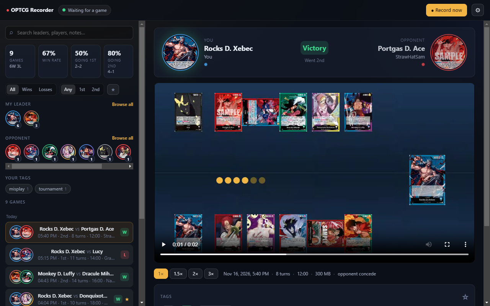
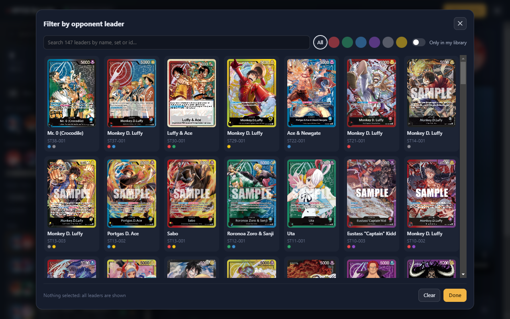

# OPTCG Recorder

Records your OPTCG Sim games automatically, tags each one from the sim's combat log
(your leader, the opponent's leader, going 1st/2nd, win/loss), and lets you search,
filter and rewatch them.



<details>
<summary>Filter by leader</summary>



</details>

## Download

**[⬇ Download the latest release](https://github.com/khoile3009/optcg-recorder/releases/latest)** (Windows)

The release page has two files; either works:

- **`OPTCG-Recorder-Setup-<version>.exe`**: installer, adds a Start menu shortcut.
- **`OPTCG-Recorder-<version>-portable.exe`**: single exe, no install, just run it.

Windows only. The builds are not code-signed, so Windows SmartScreen will say
"Windows protected your PC" the first time. Click **More info → Run anyway**.

On first start the app asks where OPTCG Sim is installed (the folder you unzipped,
like `1.31a_Windows`). It usually finds it on its own. After that, start a game in the
sim and it records; finished games show up in the library.

The player has a row of turn buttons: click **3** to jump to the start of turn 3.
Highlighted buttons are your turns; the current turn is filled in as you watch.

Above them, an event strip marks the big moments: lost lives (red for yours, gold for
your opponent's), K.O.s, Triggers and the end of the game. Click a marker to jump to a
few seconds before it. Games recorded before v0.5 have no markers.

Keyboard shortcuts in the player:

| Key | Action |
| --- | --- |
| `Space` | play / pause |
| `←` / `→` | back / forward 5 seconds |
| `[` / `]` | previous / next turn |
| `N` / `P` | next / previous event |
| `,` / `.` | slower / faster (1×, 1.5×, 2×, 3×) |

Above the filters, **Matchups** shows your win rate against each opposing leader,
overall and split by going 1st and 2nd. It follows the current filters, so pick your
leader first to see that deck's matchups. Click a row to show only those games.

### Updates

The installed version checks GitHub for new releases, downloads them in the background,
and offers **Restart to update** (otherwise the update installs the next time you quit).
The portable exe can't update itself, so it shows a **Download** link instead.
Auto-update starts with v0.4.0: if you're on v0.3.0 or older, download the new installer
once by hand.

Recordings live in `%APPDATA%\optcg-recorder\recordings` ("Open library folder" in
settings). Lower the quality in settings if files are too big.

### Sound and commentary

Recordings are silent by default. Under **Settings → Audio** you can turn on:

- **Record game sound**: captures your PC's audio output. Windows can't isolate a single
  app, so anything else that plays (music, Discord) ends up in the video too.
- **Record microphone**: pick the mic and set its volume, e.g. to commentate a game.

Both get mixed into a single audio track. The `.webm` files (VP9 + Opus) upload to
YouTube as they are.

## Develop

```bash
npm install
npm start        # run the app
npm test         # unit tests
npm run dist     # build dist/*.exe locally
```

## Cutting a release

```bash
npm version patch          # bumps package.json and creates tag vX.Y.Z
git push --follow-tags     # the Release workflow builds and publishes the exes
```
